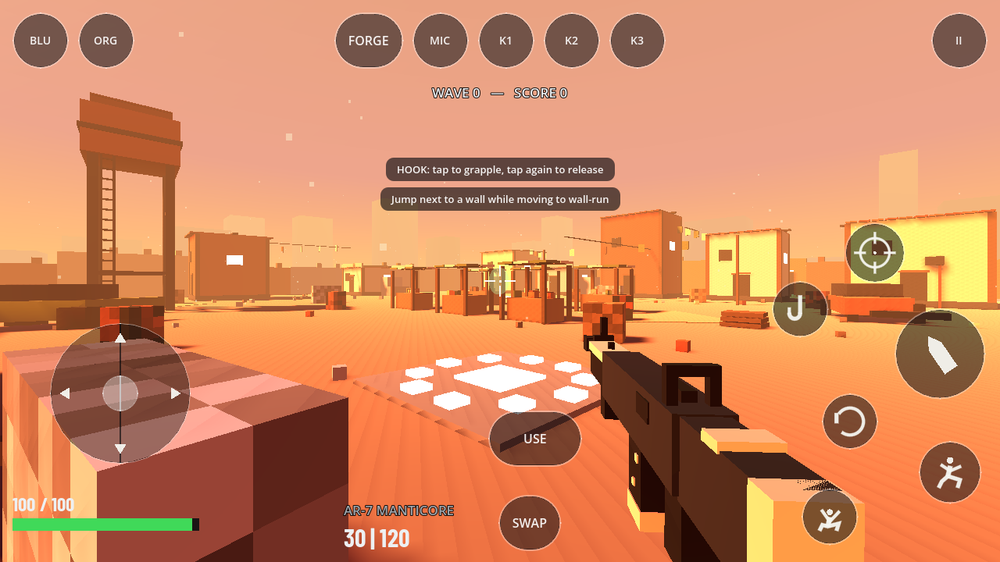

# Mobile touch HUD rework

The landscape layout follows the supplied FPS reference: a visible left movement
stick, translucent circular action discs on the right, health at bottom-left,
and weapon/ammo beside SWAP along the bottom. Existing game information and
Forge/portal/streak actions remain connected to the game; no mock match data
or decorative weapon slots have been added.

- Drag FIRE to aim while shooting. The left stick and additional look/action
  fingers keep independent ownership. Lifting one of two fingers on FIRE
  cannot release the other finger's hold.
- ADS toggles aiming. JUMP, CROUCH, HOOK and RELOAD have larger icon targets.
- USE becomes PLACE while a structure ghost is active, with a separate CANCEL.
  These send real action events, so ForgePlacement receives them. Pause also
  sends an event, rather than only changing the polled action state.
- Standard GUI touch-to-mouse translation is enabled in menus and disabled
  during gameplay. Opening a modal/pause, losing focus or resizing clears
  held actions and finger ownership.
- SWAP cycles the actual equipped weapon slots via `weapon_next`.



## Verification

Checked with Godot 4.6.3:

- `verify_touch_aim.gd`: 21 passed, including simultaneous movement/fire/look,
  multiple FIRE owners, modal cleanup, real ghost PLACE/CANCEL dispatch, and
  non-overlapping targets at 844x390, 1280x720 and 2340x1080.
- `verify_v05_c3_audio_touch.gd`: 27 passed.
- `verify_forge_b_placement.gd`: 192 passed.
- `verify_mouse_capture.gd`: 22 passed.
- `verify_v05_a4_hud.gd`: all checks passed.
- 120-frame headless boot: no script errors.
- `capture_mobile_hud.gd`: desktop OpenGL render with the real map/player/HUD.

Some existing test harnesses report resource cleanup warnings at shutdown.
The desktop render is a layout preview, not a mobile WebAssembly device test.
Export templates are not installed in this workspace. Safari/Chrome device
validation remains: drag FIRE while moving, ADS + FIRE with separate fingers,
PLACE/CANCEL after Forge, pause/resume while holding movement, native dropdown
selection, text entry, rotation, and switching browser tabs.

## Applying the patch

From the FORGEFALL repository at commit
`0ae19947d70a16910d57748b2b9f63b575a0ee45`:

```sh
git apply --check /path/to/FORGEFALL-mobile-hud.patch
git apply /path/to/FORGEFALL-mobile-hud.patch
```

Reimport in Godot and export the Web preset to update the mobile WASM build.
