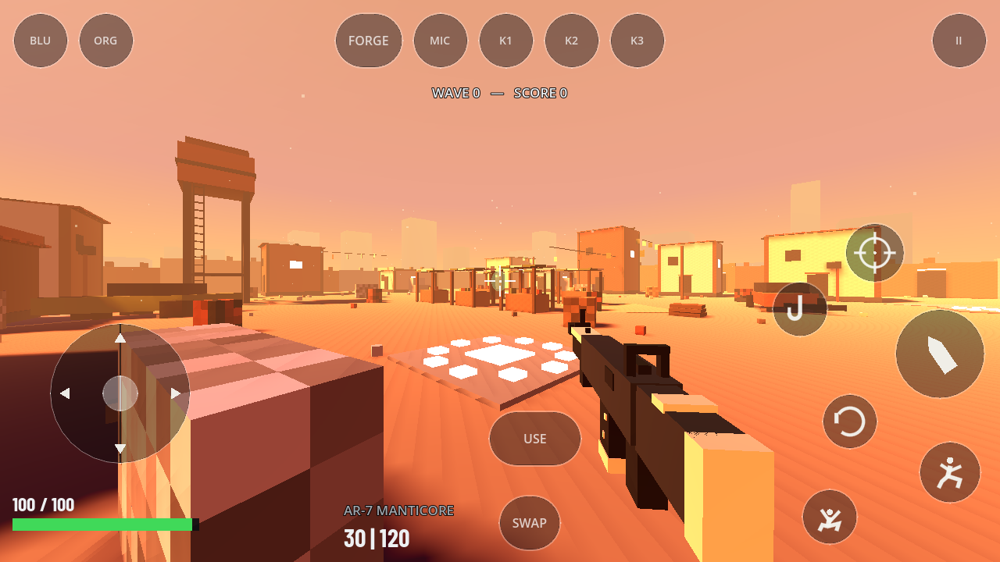
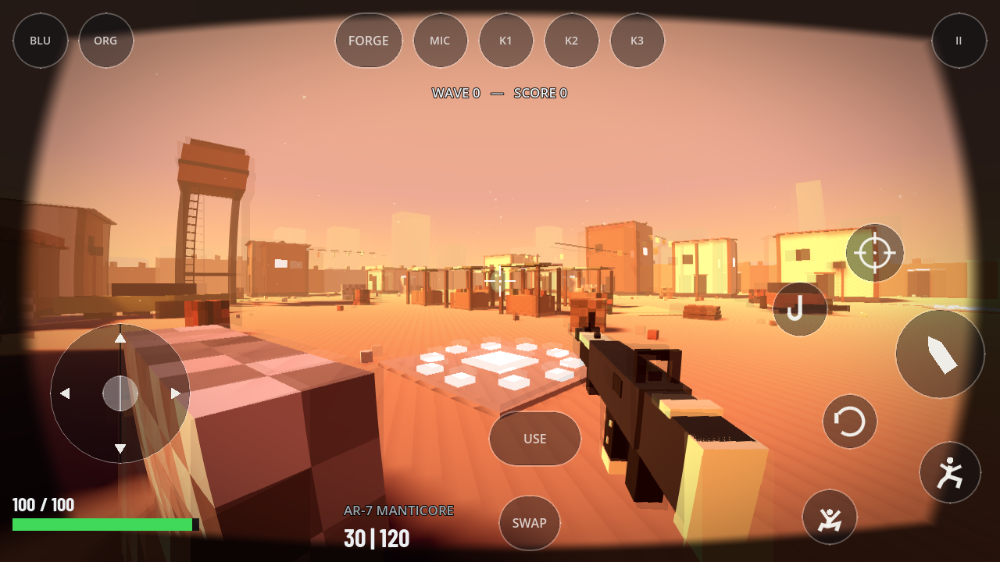
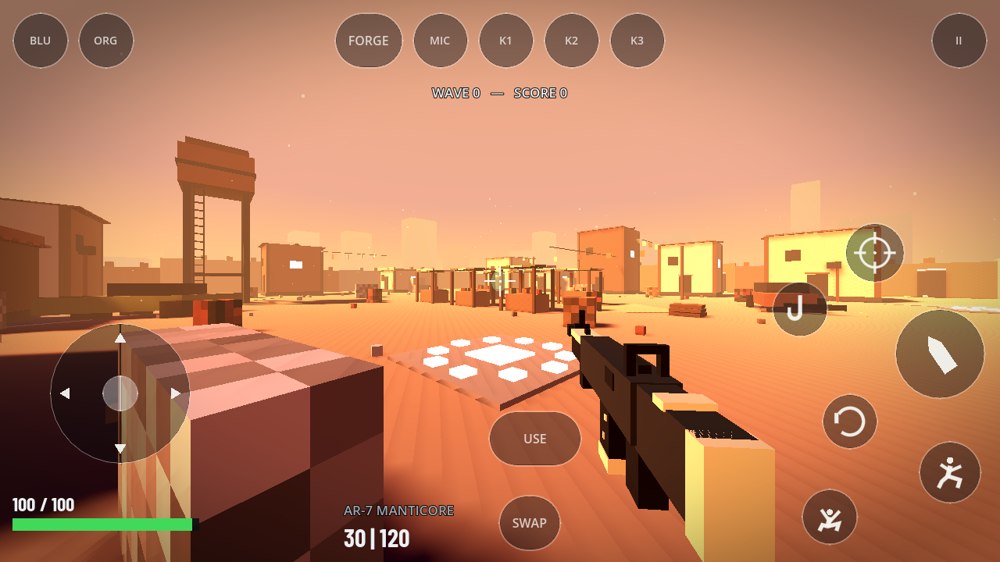
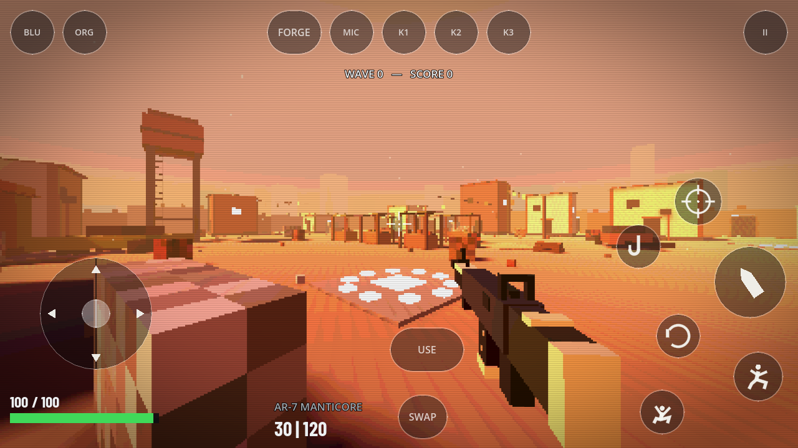
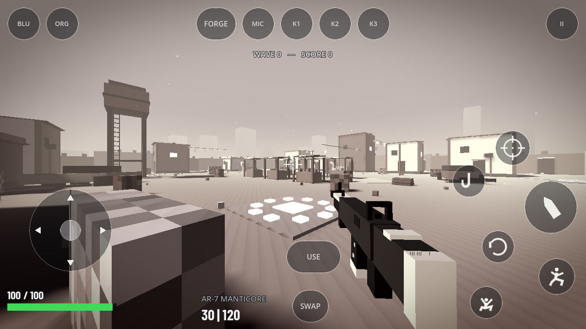
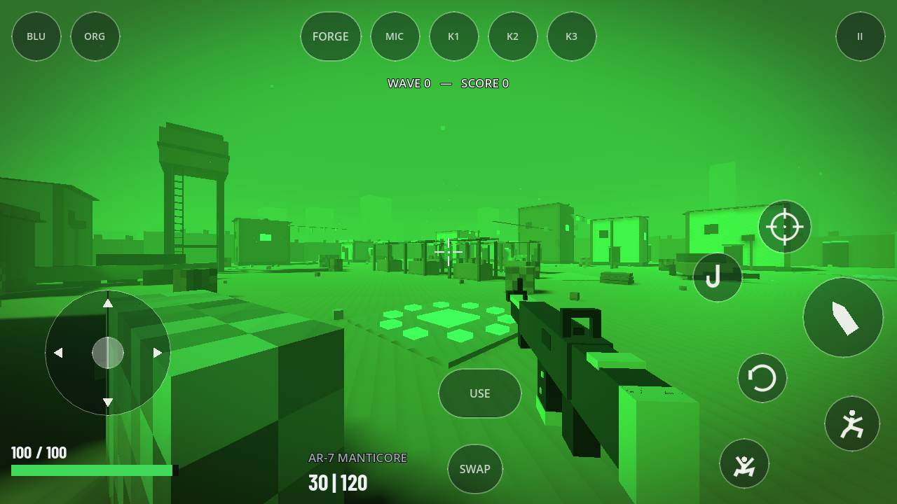

# Optional screen effects for Web and desktop

Open **Settings → Effects** in the main menu or pause menu. Enable screen effects,
choose a look, and adjust intensity. Preferences persist between runs.

| Look | Treatment |
| --- | --- |
| Bodycam | Barrel lens distortion, subdued color, contrast, optional grain and fringing |
| Cinematic | Subtle warm highlights and cool shadows, contrast, reduced saturation |
| Retro CRT | Pixelation, color quantization and optional scanlines |
| Monochrome | Black-and-white with increased contrast |
| Night vision | Cosmetic green exposure treatment; no depth or object detection |

The bodycam look is a visual treatment. It does not add chest-mounted camera
motion, change weapon animation or replace the game's art and lighting.
The existing field-of-view setting still works. Motion would be a separate
camera feature, with its own comfort controls.

## Web compatibility and cost

- Effects default to **off**. Disabling the master switch or setting intensity
  to zero hides the filter and disables its screen copy completely.
- One active look runs in one CanvasItem pass, with one explicit BackBufferCopy.
  Filters do not stack additional screen-copy passes.
- Lightweight mode is on by default. It omits Bodycam's two extra red/blue
  fringing samples, even if the fringing toggle is enabled.
- Linear screen sampling, no mipmaps, external textures, depth/normal sampling,
  compute shaders, CompositorEffect, blur kernels or render-target feedback.
- CanvasLayer -1 applies the treatment after the world and before every normal
  2D layer. Menus, HUD text and touch controls remain sharp and interactive.
- The Web feature explicitly selects Godot's Compatibility renderer. The native
  Mobile renderer setting is preserved.
- The filter is inactive outside a run. Resolution changes update its aspect.

Any enabled full-screen pass still costs GPU bandwidth, particularly on phones
with high-resolution displays. Default-off is the fastest option; lightweight
mode and disabling grain/fringing are available for experimentation. No FPS
claim is made from software-rendered tests.

## Reference and licensing

Bodycam is adapted from cyanone's **Bodycam footage**, published under CC0:
https://godotshaders.com/shader/bodycam/

That post credits zuwiwano's grain and jamesfrize's radial distortion:
https://godotshaders.com/shader/grain-old-movie/
https://godotshaders.com/shader/2d-radial-distortion-fisheye-barrel/

This implementation replaces the reference's lens calculation with a bounded
polynomial mapping, initializes every output, clamps sampled coordinates and
uses a defined feather to avoid undefined corner pixels. The other looks and
integration are FORGEFALL additions. No images from the reference were copied.

Godot screen-reading documentation:
https://docs.godotengine.org/en/stable/tutorials/shaders/screen-reading_shaders.html

## Verification

Godot 4.6.3:

- `verify_screen_effects.gd`: 16 checks passed: default bypass, live toggles,
  preset parameters, intensity, saved selection, player lifecycle and Web config.
- `effects_render_probe.tscn`: 13 GPU checks passed in desktop OpenGL
  Compatibility and again in an actual exported, single-threaded WebAssembly
  build running in Chromium/WebGL2 with SwiftShader.
- GPU checks compare each rendered look against an unfiltered image, confirm
  the HUD marker is unchanged, exercise full Bodycam fringing, and confirm zero
  intensity/master off restore the original image.
- Updated shared settings tests: 17 passed.
- Actual map/player/HUD comparison renders are included below.

The browser check verifies the shader pipeline, not mobile-device FPS or a full
mobile gameplay session. Safari and physical Android/iPhone testing remain.

Desktop GPU probe:

```sh
godot --path . --rendering-method gl_compatibility res://tools/effects_render_probe.tscn
```

Headless behavior checks (isolates saved user preferences):

```sh
XDG_DATA_HOME=/tmp/forge-effects-verification godot --headless --path . --script res://tools/verify_screen_effects.gd
```

The render probe may be temporarily selected as the main scene for a Web export.
The shipped project continues to launch its normal main menu.

## Actual game comparison

These use the same camera and intensity 0.85, with grain disabled for a stable
comparison. Settings and actual game lighting determine the final appearance.







